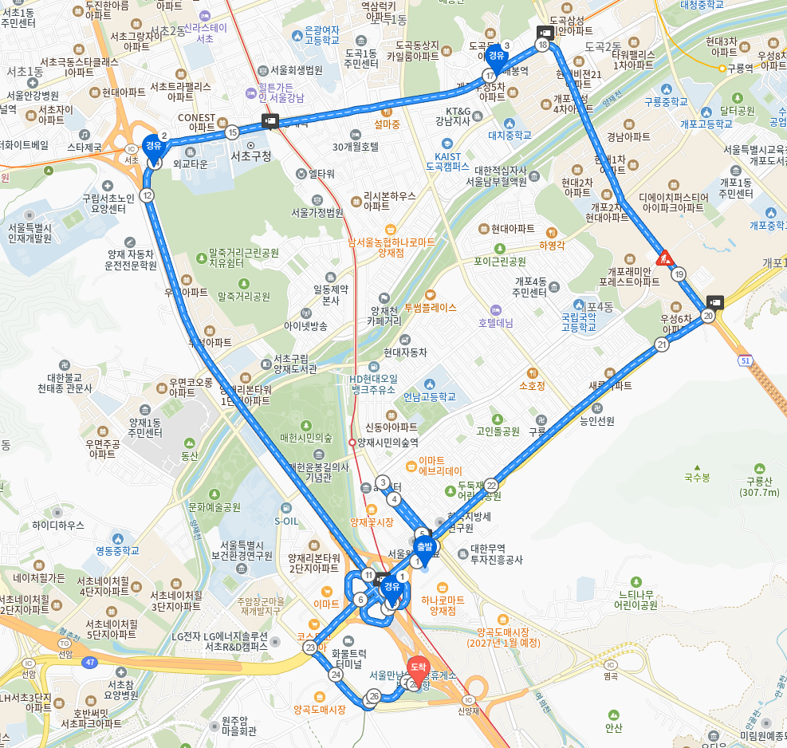
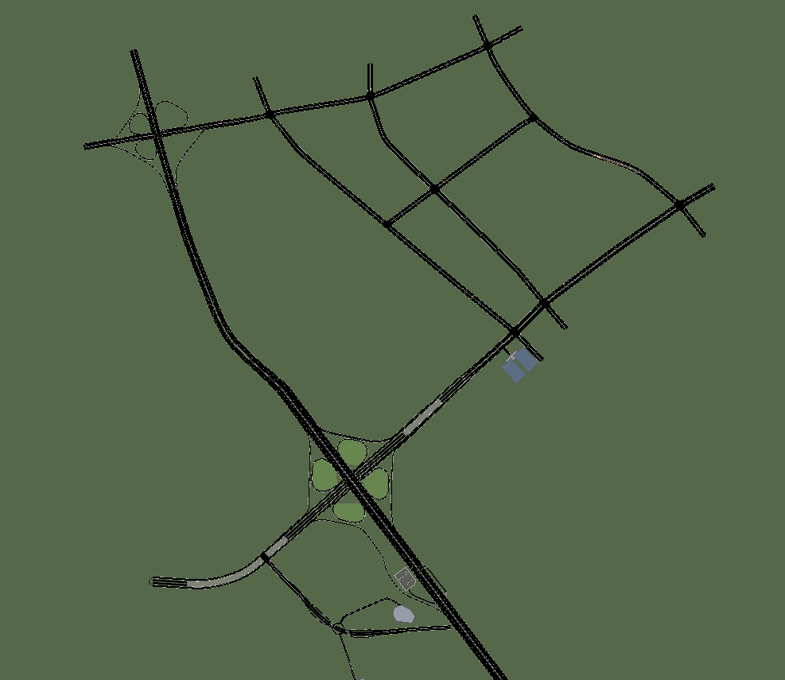

<div align="center">

# K-Driver

### SUMO 기반 차량 상호작용과 자율주행 강화학습

성균관대학교 · 자율주행인공지능및제어 · Team 9

**[Environment](Environment/README.md) · [Training](Training/README.md) · [Evaluation](Evaluation/README.md) · [Data Collection](Data_Collection/README.md) · [상세 보고서](docs/PROJECT_REPORT.md)**

</div>

<p align="center">
  
  
</p>

## Overview

**Team K-Driver**는 양재IC 주변 실제 도로를 모델링한 SUMO 환경에서 주변 차량과 상호작용하며 가감속과 차로 변경을 학습하는 자율주행 프로젝트를 수행하였습니다. 현대자동차 양재사옥에서 출발해 양재IC·서초IC·매봉역을 거쳐 서초종합체육관에 도착하는 약 **9.4 km** 경로를 구성했습니다.

대기줄 끼어들기, 합류·공사에 따른 차로 감소, 저속 차량 추월, 회전교차로 진입을 구현하고 **BC+PPO, Double DQN, PPO 개선 학습**을 비교했습니다. 팀 최종 모델은 **SAFE13·SAFE17 가중치 7:3 평균 + B·Y·S 관측 수정**을 적용한 PPO입니다.

| 최종 PPO 평가 조건 | 평가 횟수 | 완주율 | 충돌률 | 신호 위반률 |
|---|---:|---:|---:|---:|
| 기본 교통, 출발 전 300\~600초 교통 형성 | 400 | **85.25%** | **3.25%** | 9.75% |
| 출발 구간 유지, 나머지 도로 ×2·고속도로 ×3 | 100 | 84% | 5% | 6% |

최종 발표자료의 평가 결과이며, 기본 교통에서 충돌률 5% 미만 목표를 달성했습니다. 모델별 평가 조건과 개선 과정은 [상세 보고서](docs/PROJECT_REPORT.md#7-model-c-ppo-update)를 참고합니다.

## Repository Structure

```text
Team-9_K-driver/
├── Environment/          # SUMO 설치·환경 설정·도로 생성
│   └── build.py
├── Training/             # PPO 학습·추가 학습
│   └── train.py
├── Evaluation/           # 최종 모델 재생·정량 평가
│   └── evaluate.py
├── Data_Collection/      # 주행 기록 수집·데이터 명세
│   └── collect.py
├── ppo_v1_parallel/      # 실행 파일들이 사용하는 PPO 원본 구현
│   ├── algorithms/      # PPO, BC 정책
│   ├── env/             # SUMO 환경·도로·관측·보상·기록기
│   ├── utils/           # 네트워크·버퍼·병렬 환경·평가
│   └── results/         # SAFE 실험 및 MIX 최종 가중치
├── DQN_BC_PPO/
│   ├── DQN/             # Double DQN + 초기 PPO P1~P9
│   └── BC_PPO/          # BC 모방학습 + PPO 보완학습
├── docs/                 # 최종 발표 기반 상세 보고서
├── assets/               # 발표자료의 경로·도로망 이미지
└── requirements.txt
```

네 분류 폴더의 실행 파일은 `ppo_v1_parallel/`의 공통 소스를 사용합니다. 기존 `DQN_BC_PPO/`의 구현은 해당 폴더의 [안내](DQN_BC_PPO/README.md)에 따라 독립적으로 실행합니다.

## Installation

아래 명령은 **저장소 루트**에서 실행합니다. SUMO를 별도로 설치하고 실제 설치 경로로 `SUMO_HOME`과 `PATH`를 설정해야 합니다. 발표 환경은 SUMO 1.27.1이며 Python 패키지는 설치된 SUMO와 호환되는 버전을 사용합니다.

```powershell
git clone https://github.com/gofltms33-maker/Team-9_K-driver.git
cd Team-9_K-driver
python -m venv .venv
.\.venv\Scripts\Activate.ps1
python -m pip install -r requirements.txt

# 실제 SUMO 설치 위치에 맞게 수정
$env:SUMO_HOME = 'C:\Program Files (x86)\Eclipse\Sumo'
$env:PATH = "$env:SUMO_HOME\bin;$env:PATH"
sumo --version
netconvert --version
```

`libsumo`는 화면 없는 시뮬레이션을 위한 선택 의존성이며, 없으면 TraCI를 사용합니다. 자세한 설정은 [Environment](Environment/README.md)를 참고합니다.

## Environment

5종의 상황별 HV와 Krauss·IDM 일반 차량을 혼합한 도로 환경입니다. 제어 간격은 0.5초이며 최종 데이터셋 관측은 43차원입니다. 정책은 연속 가감속과 좌·유지·우 차로 선택을 출력하고, 차로 변경 안전 게이트를 거쳐 행동을 적용합니다.

```powershell
# 학습 없이 도로 파일 생성
python Environment/build.py
# 생성된 도로를 SUMO GUI로 열기
sumo-gui -c Environment/generated/highway.sumocfg
```

도로·차량·관측·보상의 수정 위치는 [환경 문서](Environment/README.md)에 정리했습니다.

## Training

```powershell
# 병렬 환경 8개로 새 PPO 실험
python Training/train.py --name PPO_parallel --n-envs 8 --timesteps 200000 --lr 2e-5 --seed 0

# 기존 SAFE13 모델에서 추가 학습
python Training/train.py --name PPO_finetune --init-model results/SAFE13_20261125_185902/eval_models/model_00053248.pt --n-envs 8
```

학습 결과와 로그는 `ppo_v1_parallel/results/`에 저장됩니다. 기본 학습 실행만으로 최종 혼합 모델이 자동 생성되지는 않습니다. 이어 학습·하이퍼파라미터·모델 선정 과정은 [Training](Training/README.md)을 참고합니다.

## Evaluation

다음 실행 파일은 기본적으로 **최종 7:3 모델, B·Y·S, 교통 형성 300\~600초**를 적용합니다.

```powershell
# 최종 AV 주행 재생
python Evaluation/evaluate.py --episodes 1

# 기본 교통에서 고정 시드 100회 평가
python Evaluation/evaluate.py --nogui --episodes 100 --seed-start 1000

# 교통량 증가 평가
python Evaluation/evaluate.py --nogui --episodes 100 --seed-start 1000 --heavy-traffic 2 3
```

이 100회 명령은 발표의 400회 전체 평가와 구분됩니다. [Evaluation](Evaluation/README.md)에서 체크포인트, 관측 수정과 조건별 성능을 확인할 수 있습니다.

## Data Collection

발표 데이터셋은 **10,417,849행 · 6,314에피소드 · 45칼럼**이며 한 행은 0.5초의 시뮬레이션 주행 기록입니다. 관측·행동·보상·주변 차량 상태·상황별 지표를 압축 CSV로 기록합니다.

```powershell
# 제공된 원본 수집기 실행 (기본 모델: SAFE13 + B)
python Data_Collection/collect.py --part 1 --rows 3334000 --workers 8
```

이 수집기의 기본 설정은 최종 7:3 + B·Y·S 전체 설정과 다릅니다. 전체 발표 데이터셋은 저장소에 포함되어 있지 않습니다. 분할 수집, 칼럼 대응과 재현 범위는 [Data Collection](Data_Collection/README.md)을 참고합니다.

## Models and Results

| 모델 | 완주율 | 충돌률 | 평가 조건 | 코드 |
|---|---:|---:|---|---|
| BC + PPO | 85.00% | 13.33% | 교통 사전 형성 없음 | [BC+PPO](DQN_BC_PPO/BC_PPO/) |
| Double DQN D4 | 58.00% | 7.00% | 교통 사전 형성, 100회 | [DQN](DQN_BC_PPO/DQN/) |
| **PPO 7:3 + B·Y·S** | **85.25%** | **3.25%** | **교통 사전 형성, 400회** | [최종 가중치](ppo_v1_parallel/results/MIX13x17_w70/model.pt) |

평가 횟수·관측·교통 조건이 달라 동일 조건의 알고리즘 성능 비교로 해석할 수는 없습니다. [상세 보고서](docs/PROJECT_REPORT.md)에 P1\~P9, BC 보완학습, DQN D1\~D4, PPO SAFE·혼합 실험과 남은 과제를 정리했습니다.

## 역할 분담

- **권도균:** 도로 및 차선 세부 수정, 중간발표 자료 제작 및 진행, 주행 데이터 수집 컬럼 구성, PPO 강화학습 및 성능 분석, BC 모방학습 및 PPO 보완학습, 학습 실패 원인 분석, Hugging Face 데이터셋 업로드, 프로젝트 페이지 제작

- **박제민:** 실제 도로 기반 SUMO 환경 구축 및 주행 경로 설계, 차량 간 상호작용 시나리오 구현, 주행 데이터 수집 코드 구성, PPO 강화학습 관측값 및 보상함수 개선, 비보호 좌회전 및 교차로 양보 판단 개선, 정차 간격 및 차선변경 문제 개선 학습, 충돌·신호위반·경로이탈 원인 분석, 최종 GitHub 코드 정리

- **김규환:** 도로 구조 전반적으로 깔끔하게 제작, 양재 IC 구현, 서초 IC 구현, 공사 현장 구현, 끊기는 부분과 IC 지하차도와 고가도로 간의 차량 구분 못하는문제 해결, P1\~P9까지 가중치 변경시키면서 학습, DQN 코드 구현, DQN 파트 가중치 변경시키면서 학습, 최종 발표 자료 제작, 최종 발표 진행

## Documentation

- [상세 프로젝트 보고서](docs/PROJECT_REPORT.md): 최종 PPT 기반 실험 과정·평가·역할 분담
- [PPO 원본 구현 안내](ppo_v1_parallel/README.md): 파일별 구성과 원본 CLI 사용법
- [기존 BC+PPO·DQN 안내](DQN_BC_PPO/README.md)
- [제출용 저장소 링크](https://github.com/gofltms33-maker/Team-9_K-driver): 프로젝트 페이지에서 연결할 코드 URL

